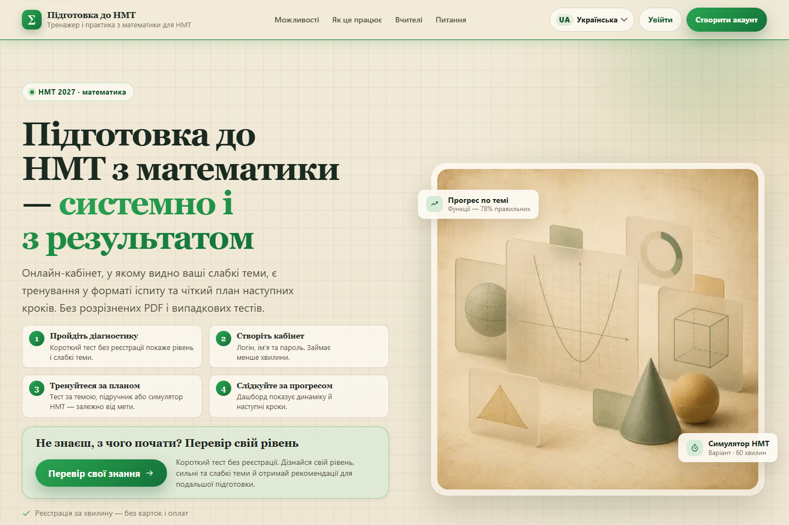
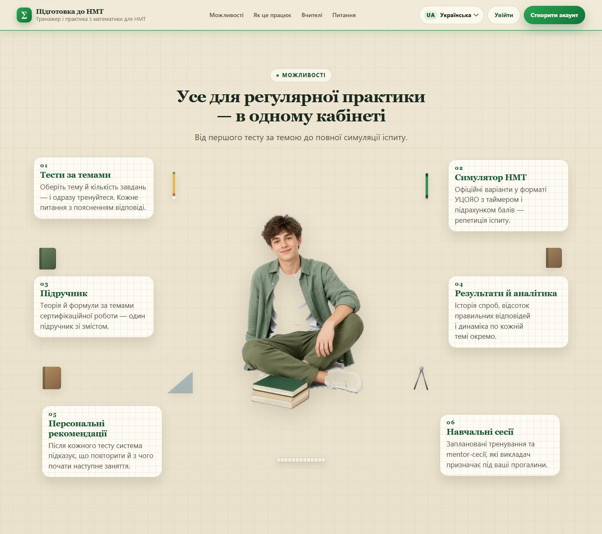
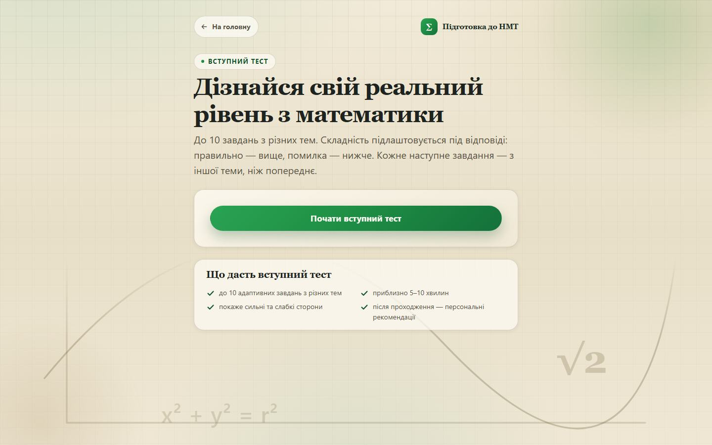
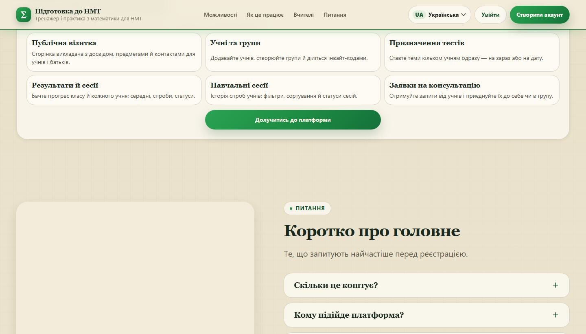
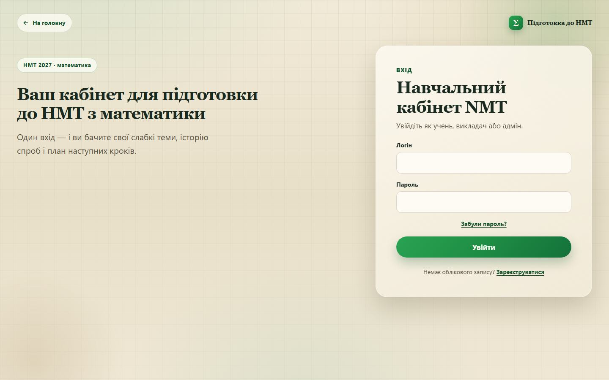

<p align="center">
  <a href="https://nmt.in.ua">
    
  </a>
</p>

<h1 align="center">nmt.in.ua</h1>

<p align="center">
  <strong>Підготовка до НМТ з математики — системно і з результатом.</strong><br>
  Онлайн-кабінет, у якому видно слабкі теми, є тренування у форматі іспиту<br>
  і зрозумілий план наступних кроків.
</p>

<p align="center">
  <a href="https://nmt.in.ua"></a>
  
  
  
  
</p>

<p align="center">
  <a href="https://nmt.in.ua"><strong>Відкрити сайт</strong></a>
  &nbsp;·&nbsp;
  <a href="https://nmt.in.ua/diagnostic"><strong>Перевірити рівень</strong></a>
  &nbsp;·&nbsp;
  <a href="https://nmt.in.ua/register"><strong>Створити акаунт</strong></a>
  &nbsp;·&nbsp;
  <a href="https://nmt.in.ua/login"><strong>Увійти</strong></a>
  &nbsp;·&nbsp;
  <a href="https://nmt.in.ua/register?role=teacher"><strong>Кабінет викладача</strong></a>
  &nbsp;·&nbsp;
  <a href="#для-розробників"><strong>Для розробників</strong></a>
</p>

<p align="center">
  
</p>

## Що це

**nmt.in.ua** — тренажер підготовки до НМТ з математики. Учень проходить діагностику, тренується за темами і на офіційних варіантах, бачить прогрес і отримує наступний крок. Викладач веде своїх учнів, призначає тести і читає результати. Адмін тримає банк завдань, профілі й денні марафони.

Кабінет учня безкоштовний: реєстрація за хвилину, без картки. Інтерфейс українською, англійською і німецькою, зручний з телефона.

| | |
| --- | --- |
| **20+** | тем сертифікаційної роботи |
| **13** | офіційних варіантів НМТ у симуляторі |
| **1** | підручник зі змістом за темами |

## Учню

- **Вступний тест без реєстрації.** До десяти завдань з різних тем. Складність росте після правильної відповіді і знижується після помилки. Наприкінці — сильні та слабкі теми.
- **Тест за темою.** Учень обирає тему і кількість завдань (видно розмір банку). Після кожної відповіді — пояснення.
- **Симулятор НМТ.** Офіційні варіанти у форматі УЦОЯО, таймер і бали. Після фінішу — розбір помилок і посилання в підручник.
- **Підручник.** Теорія і формули за темами сертифікаційної роботи, один розділ за раз.
- **Задачник.** Тест по темі, який можна роздрукувати.
- **Результати.** Спроби, середній відсоток, швидкість і динаміка по кожній темі.
- **Рекомендації.** Після тесту система підказує, що повторити і з чого почати далі.
- **Навчальні сесії.** Історія спроб і тренування, які призначив викладач.
- **Консультація.** Заявка викладачу з кабінету.
- **Денний марафон.** Загадки на лендінгу, карта днів, завдання, таблиця місць. Проходити можна на сайті або в Telegram.
- **Лідерборд.** Місця за марафоном або зведена таблиця всіх денних курсів.
- **Сповіщення.** Дзвіночок у шапці, лист і Telegram. Категорії вмикаються в кабінеті.

<p align="center">
  
</p>

<p align="center">
  
</p>

## Викладачу

Окремий кабінет після реєстрації з роллю «викладач». Публічна сторінка викладача живе за адресою `/t/slug`.

- **Публічна візитка.** Досвід, предмети, місто, опис і контакт. Учень бачить картку на вітальній і може оцінити викладача.
- **Учні.** Створити обліковий запис (логін, пошта, пароль показується один раз) або додати наявного учня за логіном.
- **Групи й коди.** Одна група на учня, особистий код і код групи. Учень приймає запрошення на `/join`.
- **Призначення тестів.** Тема, кілька учнів, «на зараз» або дата і час. У списку видно, хто вже пройшов.
- **Результати класу.** Усі учні або один. Теми від гіршого середнього, клік по темі відкриває учнів.
- **Сесії учнів.** Ті самі «усі / один», фільтри і сортування, статуси спроб.
- **Заявки на консультацію.** Черга запитів, позначки «побачено» і «закрито», кнопка «Приєднати» до себе або в групу.

<p align="center">
  
</p>

## Адмінка

Адмін входить тим самим логіном. На головній замість тренажера — редактор банку.

- **Банк завдань.** Список за темою, нове завдання, правка умови, варіантів, ключа, пояснення і складності.
- **Імпорт.** CSV або JSON на `/settings`: теми, зв’язки тем, тести і за бажанням задачник. Одна транзакція на весь файл.
- **Профілі.** Усі облікові записи, фільтр за роллю, бан і розбан, видалення. Біля імені — онлайн або коли людина була востаннє, нижче таблиця точок входу.
- **Відгуки.** Оцінки 1–10 і пропозиції користувачів. Учні чужі відгуки не бачать.
- **Марафони.** Створення курсу, публічне посилання, воронка учасників. Дні набираються з банку математики: пошук теми, кількість, заміна і перемішування. Окремо — загадки лендінгу, тексти для учасників, Telegram і вибір, кого сповістити. Таблиця місць показує всіх учасників.
- **Інструменти викладача.** Учні, групи, призначення, результати і сесії доступні й адміну.

Свій акаунт з адмінки забанити або видалити не можна.

<p align="center">
  
</p>

## Куди йти

| Сторінка | Адреса | Хто |
| --- | --- | --- |
| Вітальна | [/welcome](https://nmt.in.ua/welcome) | усі |
| Діагностика | [/diagnostic](https://nmt.in.ua/diagnostic) | усі, без акаунта |
| Реєстрація | [/register](https://nmt.in.ua/register) | гість, учень або викладач |
| Вхід | [/login](https://nmt.in.ua/login) | гість |
| Тест за темою | `/topic` | учень |
| Симулятор | `/simulator` | учень |
| Підручник | `/materials/textbook` | учень |
| Задачник | `/problems` | учень |
| Результати і сесії | `/results`, `/sessions` | учень; викладач бачить клас |
| Мої учні | `/students` | викладач, адмін |
| Призначити тест | `/assign` | викладач, адмін |
| Консультації | `/consultations` | учень пише, викладач читає чергу |
| Візитка | `/t/{slug}` | усі, якщо опублікована |
| Профілі | `/profiles` | адмін |
| Імпорт | `/settings` | адмін |
| Відгуки | `/feedback` | адмін |
| Марафони | `/admin/marathons` | адмін |

## Для розробників

Новому учаснику команди варто почати з [гіда онбордингу](docs/nmt-in-ua-onboarding-dev.md). Беклог — [docs/Goldener-Rechner-beklog-PM.md](docs/Goldener-Rechner-beklog-PM.md). Пам’ятка релізу — [`.cursor/rules/deploy-hosting.mdc`](.cursor/rules/deploy-hosting.mdc).

Потрібні Node.js 20+ і npm. Працюйте з гілки `dev`: у `main` напряму не пушимо, merge в `main` одразу деплоїть хостинг.

```bash
git clone https://github.com/tony-kobs/nmt.in.ua.git
cd nmt.in.ua
git checkout dev
npm install
cp .env.example .env.local
npm run dev
```

Локально сайт відкриється на [http://localhost:3000](http://localhost:3000).

| Команда | Що робить |
| --- | --- |
| `npm run dev` | локальна розробка |
| `npm run build` | продакшен-збірка |
| `npm start` | зібраний сайт через `server.js` |
| `npm test` | unit-тести |
| `npm run lint` | ESLint |
| `npm run migrate` | SQL-міграції |

Демо-логінів немає. Тестовий акаунт — через `/register`. Адміна підвищують у базі: `node scripts/promote-admin.mjs <login>`.

<details>
<summary>Змінні середовища, імпорт і гілки</summary>

Секрети живуть у `.env.local` (локально) або `.env.production` (хостинг). У git їх немає.

| Змінна | Призначення |
| --- | --- |
| `DB_HOST`, `DB_PORT`, `DB_USER`, `DB_PASSWORD`, `DB_NAME` | MySQL |
| `SESSION_SECRET` | cookie `nmt_session`; без неї логін на проді падає |
| `NEXT_PUBLIC_SITE_URL` | canonical URL |
| `SITE_URL` | origin у листах підтвердження і скидання пароля |
| `BREVO_API_KEY` | листи; без ключа локально текст іде в консоль |
| `CONTENT_IMPORT_API_KEY` | Bearer для `POST /api/import` |
| `ADMIN_API_KEY` | Bearer для `POST /api/admin/sessions` |
| `MAX_BODY_BYTES` | ліміт тіла HTTP на `server.js` (дефолт 8 МіБ) |
| `TELEGRAM_BOT_TOKEN`, `TELEGRAM_BOT_USERNAME`, `TELEGRAM_WEBHOOK_SECRET` | бот; без пари токен+username канал Telegram вимкнено |
| `TELEGRAM_SUPPORT_CHAT_ID` | необов’язково, чат команди для звернень; той самий `.env.production` на хості |

Порожній ключ імпорту або адмін-API відхиляє всі такі запити (`401`).

Імпорт — одна форма за запит. CSV-поля: `themes`, `themeConnections`, `quizTasks`, опційно `problems`. JSON: `file` + `format=json`.

```bash
curl -X POST http://localhost:3000/api/import \
  -H "Authorization: Bearer $CONTENT_IMPORT_API_KEY" \
  -F "themes=@themes.csv;type=text/csv" \
  -F "themeConnections=@theme_connections.csv;type=text/csv" \
  -F "quizTasks=@quiz_tasks.csv;type=text/csv"
```

Гілка фічі від свіжого `dev`, pull request у `dev`. Реліз: pull request `dev` → `main`.

</details>
